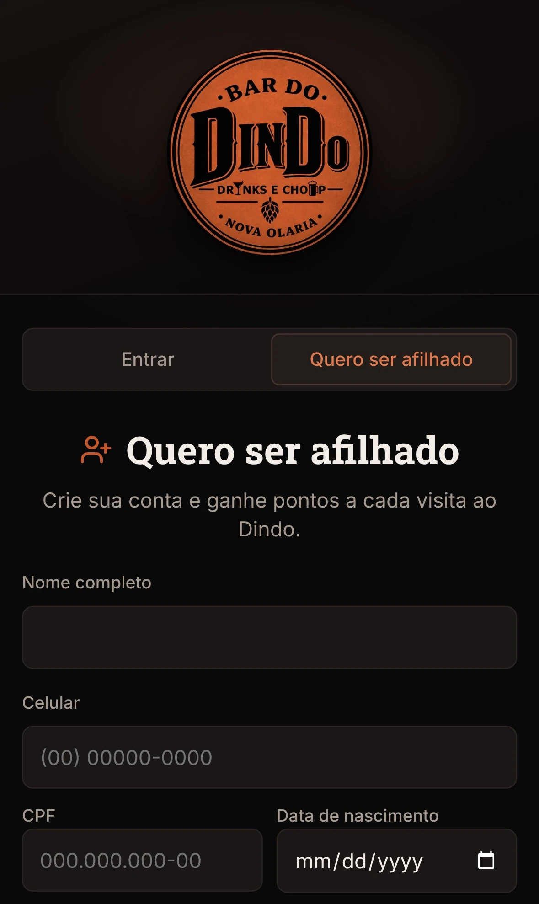
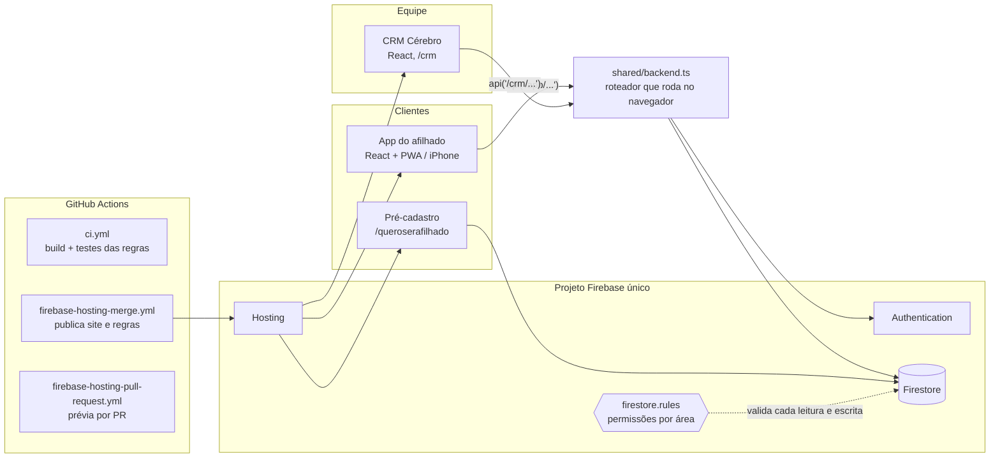

<div align="center">

# Bar do Dindo

**Sistema completo para um bar: app de fidelidade, CRM da equipe e página de pré-cadastro, tudo num único projeto Firebase, sem servidor próprio.**

[](https://github.com/GabrielPMachado/BarDoDindo/actions/workflows/ci.yml)
[](https://github.com/GabrielPMachado/BarDoDindo/actions/workflows/firebase-hosting-merge.yml)


[Arquitetura](#arquitetura) · [Como rodar](#como-rodar) · [Guia do sistema](#guia-do-sistema) · [English](#english)

</div>

<p align="center">
  
  <br />
  <sub>O app do afilhado numa tela de iPhone: entrada, cardápio e reserva de mesa. Gravado do app real no navegador; o cardápio vem do Firestore e a reserva é a tela de demonstração, que não grava nada.</sub>
</p>

## Sumário

- [Sobre](#sobre)
- [Recursos](#recursos)
- [Arquitetura](#arquitetura)
- [Stack](#stack)
- [Estrutura de pastas](#estrutura-de-pastas)
- [Como rodar](#como-rodar)
- [Testes e CI](#testes-e-ci)
- [Deploy](#deploy)
- [Decisões técnicas](#decisões-técnicas)
- [Segurança](#segurança)
- [Guia do sistema](#guia-do-sistema)
- [Licença](#licença)
- [English](#english)

## Sobre

São três partes que compartilham **um único projeto Firebase** (Authentication + Firestore), sem servidor próprio:

| Parte | Pasta | Para quem | Endereço publicado |
| --- | --- | --- | --- |
| **App do afilhado** (celular, PWA / iPhone) | raiz (`src/`) | Clientes | `/` |
| **CRM / Gestão ("Cérebro")** (computador, tablet e celular) | `crm/` | Equipe do bar | `/crm` |
| **Pré-cadastro** | `precadastro/` | Clientes, antes do lançamento | `/queroserafilhado` (o antigo `/afilhado` continua abrindo) |

Até o lançamento, o app do afilhado fica fechado na web: quem abre `/` vai para o pré-cadastro (`APP_LIBERADO` em `src/main.tsx`; para testar o app, abra `/?app=1`). O app instalado no iPhone não é afetado.

Nenhum dado vem pré-cadastrado: cardápio, recompensas, clientes, equipe e lançamentos começam vazios e são preenchidos pelo uso real.

## Recursos

**App do afilhado:** cartão de fidelidade com pontos e níveis, cardápio, recompensas com voucher, reservas de mesa, histórico, conversas com o bar, questionário de perfil e perfil do cliente.

**CRM (Cérebro):** painel executivo personalizável em grade livre, painel de atualizações da equipe, permissões por área, e módulos de Diretoria, Atendimento, Vendas, Afilhados, Marketing, Pessoal, Estrutura, Administrativo, Financeiro (com DRE), Jurídico e Fiscalização. Toda lista exporta para PDF, Excel e CSV.

**Pré-cadastro:** página pública que coleta interessados antes do lançamento.

## Arquitetura

As telas chamam `api('/app/...')` e `api('/crm/...')` como se houvesse um servidor. Quem atende essas rotas é `shared/backend.ts`, **no próprio navegador**, lendo e gravando no Firestore. O que cada pessoa pode ler ou gravar é decidido em `firestore.rules`, que funciona como a camada de segurança do back-end.



**Como as partes se conectam**

- **Cardápio e recompensas** são cadastrados no CRM e aparecem no app.
- **Reservas** são pedidas no app e confirmadas ou recusadas pela equipe no CRM.
- **Consumo e pontos:** a equipe lança a comanda do afilhado pelo número (#001…); os pontos aparecem no app e o valor entra sozinho em *Financeiro → Receita*.
- **Resgates:** o cliente gera um voucher no app, que a equipe vê em *Resgates* e dá baixa ao entregar.

## Stack

| Camada | Tecnologias |
| --- | --- |
| App do afilhado | React 19, TypeScript, React Router 7, Vite 8, `vite-plugin-pwa`, Three.js, Lucide |
| CRM | React 19, TypeScript, React Router 7, React Grid Layout, ExcelJS, jsPDF, QRCode |
| Back-end | Firebase Authentication + Cloud Firestore (regras como camada de segurança) |
| iPhone | PWA + Capacitor 8 |
| Testes | Emuladores do Firebase (Auth + Firestore) com Java 21 |
| Entrega | Firebase Hosting, GitHub Actions (CI, deploy, prévias por PR) |

## Estrutura de pastas

```
.
├── .github/workflows/
│   ├── ci.yml                            # build + testes das regras em todo push e PR
│   ├── firebase-hosting-merge.yml        # publica site e regras na main
│   ├── firebase-hosting-pull-request.yml # prévia temporária por PR
│   ├── previa-temporaria.yml             # prévia sob demanda que expira sozinha
│   └── limpar-previas.yml                # apaga prévias antigas
├── src/                  # app do afilhado (páginas, componentes, store, API)
├── crm/                  # CRM "Cérebro" (projeto Vite próprio)
│   └── src/              # páginas, módulos, coleções e componentes
├── precadastro/          # página de pré-cadastro
├── shared/
│   ├── backend.ts        # rotas /app e /crm sobre o Firestore
│   ├── firebase-config.ts
│   ├── cartao.ts         # cartão de fidelidade
│   └── questionario.ts
├── scripts/
│   ├── montar-hosting.mjs  # junta app + CRM + pré-cadastro em dist/
│   ├── semear-testes.mjs   # dados de teste nos emuladores
│   ├── testar-regras.mjs   # testes das regras de segurança
│   └── static-server.mjs   # servidor estático para testes locais
├── firestore.rules       # quem pode ler e gravar o quê
├── firestore.indexes.json
├── firebase.json         # hosting (rotas /, /crm, /queroserafilhado) e emuladores
└── capacitor.config.ts
```

## Como rodar

### Pré-requisitos

- Node.js 22+ (o CI usa o 24)
- [Firebase CLI](https://firebase.google.com/docs/cli)
- Java 21+ (só para os emuladores e os testes das regras)

### Instalação

```bash
git clone https://github.com/GabrielPMachado/BarDoDindo.git
cd BarDoDindo
npm install
npm --prefix crm install
npm run dev        # app do afilhado
npm run crm        # CRM em http://localhost:5174
```

### Configuração do Firebase

1. No console do Firebase, ative **Authentication → E-mail/senha** e crie o **Firestore** (modo produção).
2. Registre um app Web no projeto e copie a configuração para `shared/firebase-config.ts`:

   ```bash
   firebase apps:sdkconfig web --project ID-DO-PROJETO
   ```

3. Aponte a CLI para o projeto:

   ```bash
   firebase use --add ID-DO-PROJETO
   ```

### Testar localmente com os emuladores

Nada do que for feito nos emuladores vai para o projeto real.

```bash
npm run emuladores
```

Em outro terminal, compile apontando para os emuladores (PowerShell: `$env:VITE_EMULADOR = '1'`) e abra http://127.0.0.1:5000:

```bash
npm run build:all
```

### Scripts

| Comando | O que faz |
| --- | --- |
| `npm run dev` | App do afilhado em modo desenvolvimento |
| `npm run crm` | CRM em modo desenvolvimento (porta 5174) |
| `npm run build` | Checa os tipos e compila o app |
| `npm run build:all` | Compila app, pré-cadastro e CRM e junta tudo em `dist/` |
| `npm run emuladores` | Sobe os emuladores do Firebase |
| `npm run testar:regras` | Testa as regras do Firestore nos emuladores |
| `npm run serve` / `npm run serve:crm` | Serve o build localmente |
| `npm run cap:sync` | Compila e sincroniza o app do iPhone (Capacitor) |
| `npm run publicar` | Compila tudo e publica Hosting + regras |

## Testes e CI

`npm run testar:regras` sobe os emuladores, cria os dados de teste (`scripts/semear-testes.mjs`) e confere que as regras do Firestore barram o que não pode passar: cliente creditando pontos, criando voucher sem saldo, lendo salários, virando administrador e outros casos, para cada função da equipe.

| Workflow | Quando roda | O que faz |
| --- | --- | --- |
| [`ci.yml`](.github/workflows/ci.yml) | Todo push na `main` e todo pull request | Instala, checa os tipos e compila app + CRM, e roda os testes das regras |
| [`firebase-hosting-pull-request.yml`](.github/workflows/firebase-hosting-pull-request.yml) | Pull request | Testa as regras e gera um link de prévia |
| [`firebase-hosting-merge.yml`](.github/workflows/firebase-hosting-merge.yml) | Push na `main` | Testa as regras e publica site e regras; se algum teste falhar, nada é publicado |
| [`previa-temporaria.yml`](.github/workflows/previa-temporaria.yml) | Sob demanda | Prévia que expira sozinha (padrão: 30 min) |
| [`limpar-previas.yml`](.github/workflows/limpar-previas.yml) | Sob demanda | Apaga prévias; o site no ar nunca é tocado |

## Deploy

A publicação é automática a cada push na `main`. Para publicar manualmente:

```bash
npm run publicar
```

Esse comando compila o app, o pré-cadastro e o CRM, junta tudo em `dist/` e publica o Hosting e as regras do Firestore. Logo depois da primeira publicação, abra `/crm` e crie o administrador: enquanto isso não for feito, a tela de primeiro acesso fica aberta para quem tiver o endereço.

**App para iPhone (Capacitor):** com `shared/firebase-config.ts` preenchido, rode `npm run cap:sync`. Na primeira vez, `npm install @capacitor/ios` e `npx cap add ios`; depois `npx cap open ios` abre o projeto no Xcode (macOS). O app fala direto com o Firebase, sem endereço de servidor para configurar.

## Decisões técnicas

- **"Back-end" no navegador.** As telas foram escritas contra uma API REST (`api('/crm/...')`). Em vez de manter um servidor, `shared/backend.ts` implementa essas rotas sobre o Firestore no cliente. As telas não mudaram e o custo de infraestrutura é zero.
- **Regras do Firestore como autorização.** Como o código do cliente é público, toda permissão (por área: ver, criar, editar, excluir) é conferida nas regras, e não só na tela. Os testes nos emuladores garantem isso a cada PR.
- **Um projeto, três sites.** `scripts/montar-hosting.mjs` junta os três builds num único `dist/`, e o `firebase.json` direciona `/`, `/crm` e `/queroserafilhado`.
- **Totais desnormalizados.** Gasto, visitas e última visita ficam no saldo de cada afilhado (`saldos/{uid}`) e são atualizados a cada consumo, para a lista de clientes não precisar ler todos os consumos.
- **"Ao vivo" sem leituras extras.** As telas perguntam a cada 1 s se algo mudou, mas a resposta vem dos dados que já chegam em tempo real do Firestore. A primeira leitura espera o servidor (até 2,5 s) para nunca mostrar uma cópia local desatualizada.
- **Atualização sozinha.** O service worker do app procura versão nova a cada minuto, e o CRM recarrega quando não há janela aberta nem campo em edição.
- **Períodos limitados.** Receitas, despesas, consumos e reservas carregam só um período (12 meses ou 90 dias), com seletor até "Todo o período".

## Segurança

- Contas e senhas ficam no Firebase Authentication (mínimo de 6 caracteres; as telas do CRM pedem 8).
- O app e o CRM têm sessões separadas, mesmo abertos no mesmo navegador.
- **Pontos:** quem credita é a equipe (lançamento de consumo). O cliente só consegue debitar o próprio saldo junto com a criação de um voucher, e as regras recusam se o saldo não cobrir o custo.
- **Usuários do CRM:** o administrador cria a conta com uma senha inicial. Depois disso, e-mail e senha pertencem à pessoa: ela troca a senha pelo menu do usuário, ou o administrador envia um e-mail de redefinição. Excluir um usuário tira o acesso ao CRM, mas a conta continua existindo no Firebase Authentication (para apagá-la de vez, use o console do Firebase).
- **Folha:** para calcular os totais, quem tem acesso ao Financeiro consegue ler o cadastro de colaboradores no banco, embora a tela só mostre o detalhe individual para o RH.
- **Produtos:** o cardápio público é uma cópia sem custo nem margem; o Atendimento lê o cadastro completo para lançar consumo.

## Guia do sistema

<details>
<summary><b>Como os dois sistemas se conectam</b></summary>

- **Cardápio**: produtos cadastrados no CRM (*Vendas → Produtos e cardápio*), ativos e marcados "No cardápio", aparecem no app.
- **Recompensas**: o catálogo é cadastrado no CRM e aparece no app. O resgate do cliente gera um voucher que a equipe vê em *Resgates* e dá baixa ao entregar.
- **Reservas**: o cliente solicita pelo app. A equipe confirma ou recusa em *Reservas* e o cliente vê o status no app.
- **Consumo e pontos**: em *Lançar consumo* a equipe registra a comanda do afilhado pelo número (#001…) ou, em *Sem cadastro*, a venda de quem não é afilhado (sem pontos, com nome opcional). Os pontos aparecem no app e o valor entra automaticamente em *Financeiro → Receita*. Excluir o lançamento estorna pontos e receita.
- **Despesas no DRE**: o *Resultado (DRE)* soma só o que está em *Financeiro → Receitas* e *Despesas*. Em *Serviços terceirizados*, *Contratos*, *Gestão de mídias* e *Projetos*, o botão *Lançar despesa* de cada linha abre uma tela já preenchida e cria a despesa "A pagar" na competência escolhida. Quem lança é a área dona do cadastro (precisa de "Editar" nela), sem ganhar acesso ao Financeiro; o cadastro guarda o que já foi lançado em cada mês e avisa antes de repetir.
- **Parâmetros** (*Configurações*): dias e horários de reserva, ambientes, pontos por real, níveis de fidelidade e tabela do INSS.

</details>

<details>
<summary><b>Áreas do CRM</b></summary>

**Cérebro** é o nome do sistema de gestão. O menu começa por **Meu perfil** (de todo usuário: *Meus dados*, onde a pessoa vê e edita as próprias informações e troca a senha, e *Meu painel*, um painel próprio montado com os blocos e atalhos que ela quiser; também dá para trocar a foto). Depois vêm três grandes grupos: **Diretoria**, **Departamentos** (Atendimento, Vendas, Marketing, Pessoal, Estrutura, Administrativo, Financeiro, Jurídico e Fiscalização) e **Configurações**.

- **Painel de atualizações**: ao abrir o sistema aparece o que a equipe fez (cadastros, alterações, folha lançada, consumos, usuários…), com quem fez, o dia e o horário. O mesmo histórico fica no botão ao lado do perfil, no topo. Cada pessoa vê só as atualizações das áreas que ela acessa (`atividades/{área}/itens` no Firestore).
- **Painel executivo personalizável**: cada usuário escolhe como fica o seu painel. Botão direito sobre um bloco → *Fixar no topo* ou *Ocultar*; o botão *Personalizar* transforma o painel numa **grade livre** de 12 colunas: cada bloco é arrastado pela alça ⠿ para **qualquer lugar** (fica exatamente onde foi solto, pode sobrar espaço vazio, e só os blocos que ele cobriria descem) e muda de **largura e altura** pelo canto inferior direito. Há atalhos de tamanho (¼, ½, ¾ ou a linha inteira) e de lugar (início, fim, antes, depois), também no botão direito sobre o bloco; dá para mostrar de novo os ocultos e restaurar o padrão. No celular os blocos ficam empilhados na ordem de leitura. A área *Fixados*, no topo, continua em fileira. Também dá para colocar qualquer página do CRM no painel: botão direito sobre ela no menu → *Adicionar ao painel* (entra como atalho fixado no topo). O botão *Adicionar bloco* abre um catálogo com mais de 30 blocos além dos padrões, separados por área, cada um disponível só para quem acessa a área dele. O mesmo vale para o *Meu painel* de cada usuário, que é independente do Painel executivo. As escolhas ficam salvas na conta (`preferencias/{uid}` no Firestore) e valem em qualquer computador.
- **Fixar páginas**: o botão direito (ou segurar o dedo) sobre uma página do menu abre em nova guia ou janela, copia o link e **fixa** a página. As fixadas aparecem em *Meu perfil → Fixados*; clicar abre a página e expande o departamento no menu. No topo fica o caminho da página atual (Cérebro / grupo / departamento / página).

Áreas:

- **Diretoria**: painel executivo, metas e decisões
- **Atendimento**: reservas, lançar consumo, validar vouchers
- **Vendas**: produtos e cardápio, fichas técnicas, guarnições
- **Afilhados**: clientes (ficha de cada afilhado), resultado do questionário, conversas, QR Code Afilhie-se
- **Marketing**: recompensas (programa de fidelidade), criação, gestão de mídias
- **Pessoal**: colaboradores, férias e afastamentos, folha de pagamento (o lançamento como despesa é feito pelo Financeiro)
- **Estrutura**: projetos, estoque, materiais
- **Administrativo**: serviços terceirizados, fornecedores, contratos
- **Financeiro**: receitas, despesas (inclui lançar a folha), resultado (DRE)
- **Jurídico**: trabalhista, consultoria empresarial
- **Fiscalização**: controle de qualidade, não conformidades
- **Monitoramento**: câmeras (oculto por enquanto, até as câmeras serem conectadas)
- **Configurações**: usuários, funções e permissões (por área: ver, criar, editar e excluir), parâmetros

Campos que se referem a pessoas ou cadastros são vinculados: o colaborador nas férias, o responsável nas metas, o fornecedor no estoque, o afilhado na reserva etc.

</details>

<details>
<summary><b>Permissões</b></summary>

Cada função escolhe, área por área, um de 4 níveis: **Sem acesso**, **Ver**, **Editar** (ver, cadastrar e alterar) e **Total** (editar e também excluir, inclusive estornos). Por baixo cada nível vira uma lista de permissões (ver, criar, editar, excluir), que as telas, o backend e as regras do Firestore conferem uma a uma. Funções antigas, com um nível por área, continuam valendo: "Editar" equivale às quatro permissões e "Visualizar" a só ver.

</details>

<details>
<summary><b>Ao vivo e atualizações</b></summary>

O app e o CRM perguntam a cada 1 segundo se algo mudou (o pré-cadastro, a cada 1,5 s) e só então recarregam o que está na tela. A resposta vem dos dados que já chegam em tempo real do Firestore, então isso não gasta leituras extras. A primeira leitura de cada consulta espera a resposta do servidor (até 2,5 s), para nunca mostrar uma cópia local desatualizada.

Versões novas também entram sozinhas: o app (service worker) procura atualização a cada minuto, e o CRM confere se o site mudou e recarrega quando não há janela aberta nem campo em edição.

</details>

<details>
<summary><b>Administração, períodos, valores e clientes</b></summary>

- **Excluir afilhado** (Afilhados → Clientes): apaga o cadastro, o saldo, os consumos (com as receitas), os vouchers e as reservas do afilhado. Exige permissão de excluir em Vendas e em Atendimento.
- **Numeração dos afilhados** (Configurações → Parâmetros): mostra o próximo número e, depois de excluir afilhados, ajusta para voltar a seguir o maior número em uso.
- **Períodos:** receitas, despesas, consumos e reservas crescem com o tempo, então as telas carregam só um período (12 meses para receitas e despesas, 90 dias para reservas e consumos), com um seletor que vai até "Todo o período". Contas a pagar em aberto aparecem sempre.
- **Valores em R$:** os campos aceitam a digitação natural: "150" vira R$ 150,00 e "18,5" vira R$ 18,50.
- **Clientes:** gasto total, visitas e última visita vêm de totais guardados no saldo de cada afilhado (`saldos/{uid}`: `gasto`, `lancamentos`, `dias`), atualizados a cada consumo lançado ou estornado. Saldos antigos, sem esses totais, são calculados uma vez a partir dos consumos e gravados na primeira abertura da lista por alguém do Atendimento.

</details>

<details>
<summary><b>Celular e tablet</b></summary>

O CRM se adapta à tela. No tablet e no celular o menu lateral vira uma gaveta (botão ☰), as grades viram uma coluna e, no celular, as tabelas viram cartões e as janelas ocupam a tela inteira. Como no toque não há botão direito, **segurar o dedo** sobre uma página do menu ou um bloco do painel abre o mesmo menu (fixar, adicionar ao painel…), e no modo *Personalizar* as setas ↑↓ mudam os blocos de lugar.

</details>

<details>
<summary><b>Fotos e exportação</b></summary>

Produtos, estoque, materiais, recompensas, peças de criação, publicações e colaboradores podem ter **foto** (a imagem é reduzida no navegador antes de salvar; aparece como miniatura na tabela e nos produtos de *Lançar consumo*). Toda lista de cadastro tem **Exportar → PDF** (com a logo, título, data, fotos, status coloridos, totais e páginas numeradas), **Excel (.xlsx)** (faixa de título com a logo e a data, cabeçalho laranja fixo com filtro, linhas zebradas com bordas, status coloridos, valores como números e datas de verdade, linha de totais com fórmula, fotos centralizadas nas células e pronto para imprimir em A4 com número de página) e **CSV**.

</details>

## Licença

Projeto de [Gabriel Pinto Machado](https://github.com/GabrielPMachado). Todos os direitos reservados.

---

## English

<details open>
<summary><b>Bar do Dindo: loyalty app, staff CRM and pre-registration for a bar</b></summary>

### About

A complete system for a bar in three parts sharing **one Firebase project** and no custom server: a customer loyalty app (PWA and iPhone), a staff CRM called "Cérebro" (sales, finance with P&L, HR, inventory, marketing and more) and a pre-registration page used before launch.

### Architecture

The screens call `api('/app/...')` and `api('/crm/...')` as if there were a REST server. Those routes are implemented by `shared/backend.ts`, **running in the browser** on top of Firestore, and `firestore.rules` is the authorization layer (per-area view/create/edit/delete permissions). See the [diagram above](#arquitetura).

### Getting started

```bash
git clone https://github.com/GabrielPMachado/BarDoDindo.git
cd BarDoDindo
npm install && npm --prefix crm install
npm run dev     # customer app
npm run crm     # staff CRM on port 5174
```

Fill `shared/firebase-config.ts` with your Firebase web config, then `firebase use --add <project-id>`. `npm run emuladores` runs everything against local emulators.

| Script | Description |
| --- | --- |
| `npm run build:all` | Build app, pre-registration and CRM into `dist/` |
| `npm run testar:regras` | Test Firestore rules on the emulators |
| `npm run publicar` | Build and deploy Hosting + rules |

### CI and deploy

`ci.yml` type-checks and builds the app and the CRM and runs the Firestore rules tests on every push and pull request. Pull requests get a temporary preview link, and every push to `main` is tested and deployed to Firebase Hosting; if a rules test fails, nothing is published.

### Key decisions

- A browser-side "back end" that keeps a REST-shaped API with zero infrastructure
- Firestore rules as the real authorization layer, covered by emulator tests
- One Firebase project serving three sites from a single `dist/`
- Denormalized totals and bounded periods to keep reads cheap

### License

By [Gabriel Pinto Machado](https://github.com/GabrielPMachado). All rights reserved.

</details>
